<!-- 🌸 Save as README.md in a public repo named exactly: Priyachakraborty-hash -->

<div align="center">



<a href="https://git.io/typing-svg">
  
</a>

<br/><br/>

✨ 🌷 ⋆｡°✩ 🌸 ⋆｡°✩ 🌺 ⋆｡°✩ 🌼 ⋆｡°✩ 🌸 ⋆｡°✩ 🌷 ✨

</div>

<br/>


I'm a **Software Engineer** with 6+ years of experience building secure, privacy-first distributed systems and event-driven microservices. I love clean architecture, reliable systems, and lately, agentic AI. 💫

```text
💐 Name          →  Priya Chakraborty
🎓 Education     →  MS Computer Science (AI track), SUNY Binghamton
📍 Based in      →  New York
💼 Experience    →  John Deere (via HCL) · Thomson Reuters (via TCS)
🌱 Exploring     →  Agentic AI, RAG, LLM integrations
💬 Ask me about  →  Spring Boot, Kafka, Kubernetes, system design
```

<br/>


<div align="center">

**🌼 Languages**


**🌸 Backend & Frontend**


**🌺 Data & Messaging**


**🌻 Cloud & DevOps**


**🌷 AI / ML**


**🌼 Testing**


</div>

<br/>


| 🌸 Role | 🏢 Company | 📅 When | ✨ Highlights |
|:--|:--|:--|:--|
| **Software Engineer** | John Deere (via HCL) | Feb 2023 – Aug 2024 | Secure Spring Boot microservices, Kafka event-driven systems, Docker/Kubernetes, CI/CD with Jenkins & Argo. Improved reliability by 68% |
| **Systems Engineer** | Thomson Reuters (via TCS) | Mar 2018 – Feb 2023 | Led secure backend architecture in Java/Spring, resilient privacy-first APIs, improved performance by 80%, mentored the team |

<br/>


### 🌦️ [WeatherWheels: Smart Marketplace](https://github.com/Priyachakraborty-hash/weatherwheels-project)
An event-driven microservices platform that recommends agricultural equipment using real-time weather data and seasonal patterns.
- 6 independent microservices (weather, product, recommendation, user, order, notification) with Eureka service discovery and RabbitMQ messaging
- Clean REST contracts, SOLID principles, normalized MySQL schemas, and a React frontend


### ☁️ AI Cloud Cost Detection Tool
An agentic AI system that analyzes Azure cost data and flags over-provisioned resources, cutting manual audit time from 4+ hours to about 30 minutes per resource group.
- Multi-agent workflow with RAG-based context retrieval and autonomous recommendations
- Conversational agent for multi-turn stakeholder Q&A


### 🌿 More from my repos
<div align="center">

| 🌸 Repo | 🛠️ Language |
|:--|:--:|
| [IndexAnalyzer](https://github.com/Priyachakraborty-hash/IndexAnalyzer) | Python |
| [SALSA](https://github.com/Priyachakraborty-hash/SALSA) | Java |
| [loganalyzer](https://github.com/Priyachakraborty-hash/loganalyzer) | Python |
| [ota-localizer](https://github.com/Priyachakraborty-hash/ota-localizer) | Python |

</div>

<br/>


<div align="center">


<br/>


</div>

<br/>


<div align="center">

[](https://www.linkedin.com/in/priyac19/)
[](mailto:chakrabortypriyaoff@gmail.com)
[](https://github.com/Priyachakraborty-hash)

<br/>

> 🌸 *"Be a flower that blooms in code."* 🌸


✨ 🌸 ✨ thanks for stopping by ✨ 🌸 ✨

</div>
